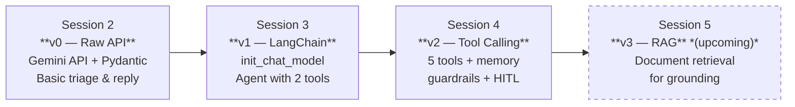

# 🚀 Grow with Data: Industrial Training Portfolio

Welcome to my central repository tracking my progress, learnings, and projects developed during my Industrial Training at **Grow with Data**.

This repository serves as a living portfolio documenting end-to-end LLM engineering — progressing from raw API calls and schema validation to multi-tool autonomous agents with stateful memory and security guardrails.

Each session is organized into:
- **`What_I_Learnt`**: Interactive notebooks and experiments exploring new concepts.
- **`Task`**: Practical, production-grade iterations of the core project: **Northstar Triage Assistant**.

---

## 🛠️ Tech Stack & Ecosystem

- **Languages:** Python 3.10+
- **Agent Orchestration & Memory:** LangChain, LangGraph (`InMemorySaver`)
- **Validation & Schemas:** Pydantic v2
- **Configuration & Prompts:** PyYAML
- **AI Models & Inference:**
  - Google Gemini API (`gemini-3.1-flash-lite`) via `google-genai` / `langchain-google-genai`
  - Local LLMs via Ollama (`llama3.2:3b`)
- **Observability & Tracing:** LangSmith
- **Development Environment:** Jupyter Notebooks

---

## 📚 Session Index

| Session | Topic / Focus | Core Project / Task | Status |
| :--- | :--- | :--- | :---: |
| **[Session 1](./Session_1)** | Introduction to LLMs, Tokenomics & API Integration | Foundation setup & environment configuration | ✅ Completed |
| **[Session 2](./Session_2)** | Prompt Engineering & Structured Outputs (v0) | [Northstar Triage Assistant v0](./Session_2/Task) | ✅ Completed |
| **[Session 3](./Session_3)** | LangChain Integration & Agent Tools (v1) | [Northstar Triage Assistant v1](./Session_3/Task) | ✅ Completed |
| **[Session 4](./Session_4)** | Tool Calling, Checkpoint Memory & Guardrails (v2) | [Northstar Triage Assistant v2](./Session_4/Task) | ✅ Completed |
| **Session 5** | Retrieval-Augmented Generation (RAG) (v3) | Vector DB grounding & document retrieval | 🔜 In Progress |

---

## 🌟 Flagship Project: Northstar Services Support Assistant

The centerpiece of this training is the progressive development of the **Northstar Support Assistant**, an enterprise SaaS customer support system that evolves with each session:



- **v0 (Session 2):** Pure Python + Google GenAI SDK. Enforces strict JSON categorization (`category`, `urgency`, `sentiment`, `need_human`, `summary`) and drafts empathetic replies with real-time token/cost accounting.
- **v1 (Session 3):** Standardized using LangChain's `init_chat_model`. Adds autonomous agent drafting using LangChain's `create_agent` with simulated domain tools (`lookup_account`, `get_knowledge_base_article`).
- **v2 (Session 4):** Full-stack agent featuring:
  - **5 Domain Tools:** `lookup_customer`, `list_invoices`, `check_refund_status`, `get_return_policy`, `issue_refund`.
  - **Conversational Memory:** Thread-isolated persistence via LangGraph `InMemorySaver`.
  - **Defense-in-Depth Middleware:** `policy_guard` (prompt injection defense), `ToolRetryMiddleware`, `ModelCallLimitMiddleware`, and `HumanInTheLoopMiddleware` for gated refund approval.
  - **Output Contracts:** `Resolution` schema guaranteeing audited tool usage.

---

## 📁 Repository Structure

```text
Grow-With-Data-Training/
├── README.md
├── .gitignore
├── Session_1/
│   └── README.md
├── Session_2/
│   ├── What_I_Learnt/
│   │   ├── README.md
│   │   └── session2.ipynb
│   └── Task/
│       ├── README.md
│       ├── prompt.yml
│       └── session2taskcode.ipynb
├── Session_3/
│   ├── What_I_Learnt/
│   │   ├── README.md
│   │   └── session3.ipynb
│   └── Task/
│       ├── README.md
│       ├── prompt.yml
│       └── session3taskcode.ipynb
└── Session_4/
    ├── What_I_Learnt/
    │   ├── README.md
    │   ├── session4.ipynb
    │   ├── session4.py
    │   └── prac4.ipynb
    └── Task/
        ├── README.md
        ├── prompt.yml
        └── session4taskcode.ipynb
```

---

## 🚀 Getting Started Locally

1. **Clone the repository:**
   ```bash
   git clone https://github.com/mr-captrox/Industrial-Training---Grow-With-Data.git
   cd Industrial-Training---Grow-With-Data
   ```

2. **Create and activate a virtual environment:**
   ```bash
   python3 -m venv .venv
   source .venv/bin/activate  # On Windows: .venv\Scripts\activate
   ```

3. **Install dependencies:**
   ```bash
   pip install pydantic pyyaml python-dotenv langchain langgraph langchain-google-genai google-genai langchain-ollama
   ```

4. **Configure environment variables:**
   Create a `.env` file in the root directory:
   ```env
   GOOGLE_API_KEY=your_gemini_api_key_here
   LANGSMITH_TRACING=true
   LANGSMITH_API_KEY=your_langsmith_api_key_here
   ```

5. **Launch Jupyter Lab / Notebooks:**
   ```bash
   jupyter notebook
   ```

---
*Developed by [captrox](https://github.com/mr-captrox)*
